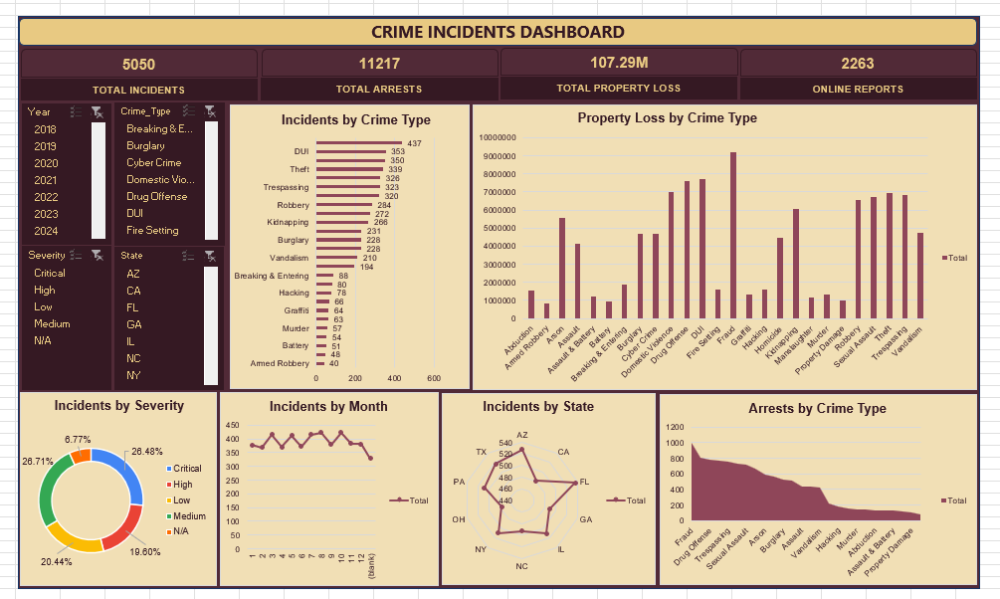

# Crime Incidents & Public Safety Analytics

## Project Overview

**Crime Incidents & Public Safety Analytics** is an Excel-based data analytics project focused on analyzing crime incidents, arrests, property loss, severity levels, and reporting patterns. The project uses data cleaning, PivotTables, PivotCharts, and interactive slicers to transform raw incident records into an interactive dashboard.

The dashboard helps users explore crime patterns across different years, crime types, severity levels, and states.

## Dashboard Preview

## Tools & Technologies

- Microsoft Excel
- Data Cleaning and Data Transformation
- Excel Tables and Formulas
- PivotTables and PivotCharts
- Interactive Slicers
- Dashboard Design and Data Visualization

## Workbook Structure

The Excel workbook contains four sheets:

### 1. Raw Data — `crime_incidents_messy_rawdata`

Contains the original crime incident records, including crime types, locations, incident dates and times, suspect and victim details, weapons, severity, case status, arrests, property loss, and online reporting information.

### 2. Cleaned Data — `crime_incidents_messy_cleaned`

Contains the cleaned and standardized incident data, with **5,050 incident records** and 30 columns.

Data preparation includes:

- Standardizing crime type names and categorical values.
- Cleaning and organizing location information.
- Standardizing suspect and victim attributes.
- Handling missing and invalid values.
- Cleaning numerical fields such as suspect age, victim age, arrests, and property loss.
- Preparing date and time fields for time-based analysis.
- Creating Year, Month, Day, Day of Week, Hour, Minute, and Second fields.

### 3. Pivot Tables — `pivot_table`

Contains summary tables used to analyze incident counts, arrests, property loss, and other crime characteristics.

The analysis covers:

- Crime type
- Severity
- Month
- Hour
- Day of week
- Weapon used
- Resolution
- State
- District
- Case status
- Online reporting

### 4. Dashboard — `Dashboard`

An interactive dashboard that combines KPI cards, charts, and slicers to present key information in a single view.

## Key Performance Indicators (KPIs)

The dashboard includes four key metrics:

- **Total Incidents:** 5,050
- **Total Arrests:** 11,217
- **Total Property Loss:** $107.29 million
- **Online Reports:** 2,263

These values represent the overall totals displayed by the workbook. Interactive filters may change the values shown in the dashboard.

## Dashboard Visualizations

The dashboard includes six chart types:

1. **Incidents by Crime Type — Horizontal Bar Chart:** Compares incident counts across crime categories.
2. **Property Loss by Crime Type — Column Chart:** Compares reported property loss across crime categories.
3. **Incidents by Severity — Doughnut Chart:** Shows the distribution of incidents across severity levels.
4. **Incidents by Month — Line Chart:** Displays monthly incident-count patterns.
5. **Incidents by State — Radar Chart:** Compares incident counts across the states represented in the analysis.
6. **Arrests by Crime Type — Area Chart:** Visualizes arrest counts across crime categories.

## Interactive Features

The dashboard includes slicers for:

- Year
- Crime Type
- Severity
- State

Users can select one or more filter values to explore the data and examine how the dashboard changes according to their selections.

## Project Objectives

- Clean and standardize raw crime incident data.
- Summarize incident counts, arrests, and property loss.
- Analyze crime patterns by category, severity, location, and time.
- Build an interactive Excel dashboard for data exploration.
- Present key metrics and visual comparisons in a single dashboard.

## Key Outcomes

- Prepared a structured dataset containing 5,050 cleaned incident records.
- Created PivotTables to summarize multiple crime-related dimensions.
- Built a dashboard with four KPI cards and six different chart types.
- Added interactive slicers to support filtered analysis.
- Organized the workbook into raw data, cleaned data, analysis, and dashboard sheets.

## How to Use

1. Download the Excel workbook from this repository.
2. Open it in Microsoft Excel.
3. Navigate to the **Dashboard** sheet.
4. Use the Year, Crime Type, Severity, and State slicers to filter the analysis.
5. Explore the charts to compare crime incidents, property loss, and arrests.
6. Navigate to the other sheets to inspect the cleaned dataset and PivotTables.

## Repository Contents

- `DashBoard.png` — Dashboard preview image.
- `Kintala Balaji - 8465019018.xlsx` — Excel workbook containing the raw data, cleaned data, PivotTables, and dashboard.
- `README.md` — Project documentation.

## Conclusion

This project demonstrates practical Excel data analytics skills, including data cleaning, aggregation, PivotTables, chart creation, and interactive dashboard development. It provides a structured way to explore crime incident patterns and communicate findings through visual analysis.

